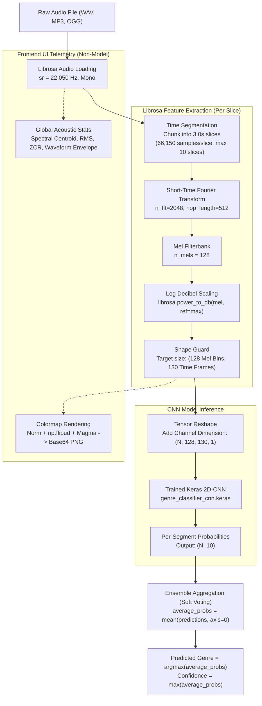
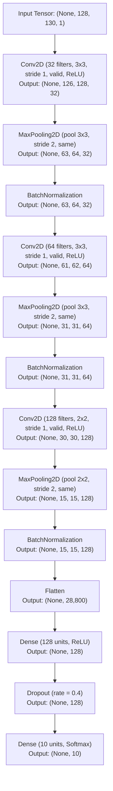

# Music Genre Classification: Workflow & CNN Architecture

## 1. Images vs. Audio Features: What Does the Model Actually Use?

> **Direct Answer:**  
> The model **does NOT use image files** (e.g., PNG, JPG, or decoded pixel graphics).  
> It operates directly on **numerical audio features extracted via `librosa`** — specifically a **2D Log Mel-Spectrogram matrix**.

### Technical Explanation
- **What the Model Consumes:**  
  `librosa.feature.melspectrogram` computes a **floating-point 2D NumPy array** of shape `(128, 130)` representing decibel energy levels across 128 frequency bands over 130 time slices. A singleton channel is added to make it a 4D tensor: `(batch_size, 128, 130, 1)`.
- **Why a 2D CNN is Used:**  
  A 2D Convolutional Neural Network does not require RGB/PNG images. It requires **2-dimensional spatial/temporal matrices** with local correlations. A spectrogram places frequency on the vertical axis and time on the horizontal axis, allowing standard 2D convolution filters to detect acoustic patterns (harmonics, pitch contours, percussion transients).
- **Where Images Come In:**  
  Image generation (`generate_spectrogram_image_data()` using Matplotlib/PIL) occurs **only in the API response layer** to render a base64 PNG data URL strictly for displaying visual heatmaps in the frontend web UI. The neural network never touches this image.

---

## 2. End-to-End Processing Workflow

### Workflow Steps Breakdown
1. **Audio Ingestion & Resampling:**  
   The audio signal is decoded and resampled to **22,050 Hz** single-channel (mono) floating-point values in `[-1.0, 1.0]`.
2. **Segmentation:**  
   The track is divided into fixed **3.0-second non-overlapping windows** ($22,050 \times 3 = 66,150$ samples each), capturing up to 10 segments (30 seconds total).
3. **Log Mel-Spectrogram Extraction:**  
   - FFT Window (`n_fft`): $2048$ samples ($\approx 93\text{ ms}$).
   - Hop Length (`hop_length`): $512$ samples ($\approx 23\text{ ms}$ step size).
   - Frequency Bins (`n_mels`): $128$ non-linear Mel bands ($0\text{ Hz}$ to $11,025\text{ Hz}$).
   - Time Frames: $1 + \lfloor 66,150 / 512 \rfloor = 130$ frames.
   - Dynamic Range Compression: Converted from power to decibels using peak reference: $10 \log_{10}(\text{mel} / \max(\text{mel}))$.
4. **Batch Tensor Construction:**  
   All $N$ valid segments are stacked and expanded along the channel axis: `shape = (N, 128, 130, 1)`.
5. **Batch Forward Pass & Soft Voting:**  
   The CNN outputs a $(N, 10)$ probability distribution. Segment outputs are averaged across time (soft-voting ensemble) to produce a single stable prediction for the track.

---

## 3. CNN Architecture Specification

The model is a Sequential 2D Convolutional Neural Network trained on the 10 GTZAN genres (*blues, classical, country, disco, hiphop, jazz, metal, pop, reggae, rock*).

### Layer Diagram

### Detailed Layer Parameters

| # | Layer Type | Parameters / Kernel | Strides | Padding | Activation | Output Shape | Trainable Params |
|---|---|---|---|---|---|---|---|
| **0** | **Input** | — | — | — | — | `(None, 128, 130, 1)` | 0 |
| **1** | `Conv2D` | 32 filters, $(3 \times 3)$ | $(1, 1)$ | `valid` | ReLU | `(None, 126, 128, 32)` | 320 |
| **2** | `MaxPooling2D` | Pool $(3 \times 3)$ | $(2, 2)$ | `same` | — | `(None, 63, 64, 32)` | 0 |
| **3** | `BatchNormalization`| Momentum 0.99, Epsilon 0.001 | — | — | — | `(None, 63, 64, 32)` | 128 |
| **4** | `Conv2D` | 64 filters, $(3 \times 3)$ | $(1, 1)$ | `valid` | ReLU | `(None, 61, 62, 64)` | 18,496 |
| **5** | `MaxPooling2D` | Pool $(3 \times 3)$ | $(2, 2)$ | `same` | — | `(None, 31, 31, 64)` | 0 |
| **6** | `BatchNormalization`| Momentum 0.99, Epsilon 0.001 | — | — | — | `(None, 31, 31, 64)` | 256 |
| **7** | `Conv2D` | 128 filters, $(2 \times 2)$ | $(1, 1)$ | `valid` | ReLU | `(None, 30, 30, 128)` | 32,896 |
| **8** | `MaxPooling2D` | Pool $(2 \times 2)$ | $(2, 2)$ | `same` | — | `(None, 15, 15, 128)` | 0 |
| **9** | `BatchNormalization`| Momentum 0.99, Epsilon 0.001 | — | — | — | `(None, 15, 15, 128)` | 512 |
| **10**| `Flatten` | Flatten $15 \times 15 \times 128$ | — | — | — | `(None, 28800)` | 0 |
| **11**| `Dense` | 128 hidden units | — | — | ReLU | `(None, 128)` | 3,686,528 |
| **12**| `Dropout` | Rate = 0.4 (40% neurons dropped)| — | — | — | `(None, 128)` | 0 |
| **13**| `Dense` (Output) | 10 classes | — | — | Softmax | `(None, 10)` | 1,290 |

### Parameter Summary
- **Total Parameters:** 3,740,426
- **Trainable Parameters:** 3,739,978 (~14.27 MB)
- **Non-Trainable Parameters (BatchNorm):** 448 (~1.75 KB)
- **Classification Output Classes (10):**  
  `blues`, `classical`, `country`, `disco`, `hiphop`, `jazz`, `metal`, `pop`, `reggae`, `rock`
